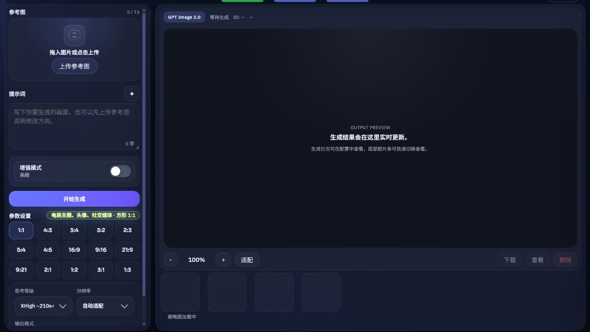
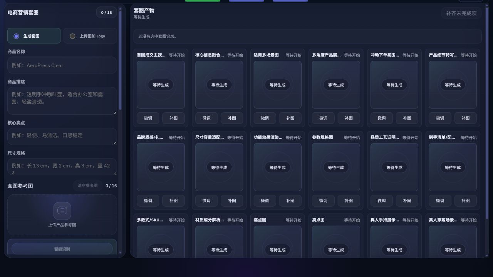
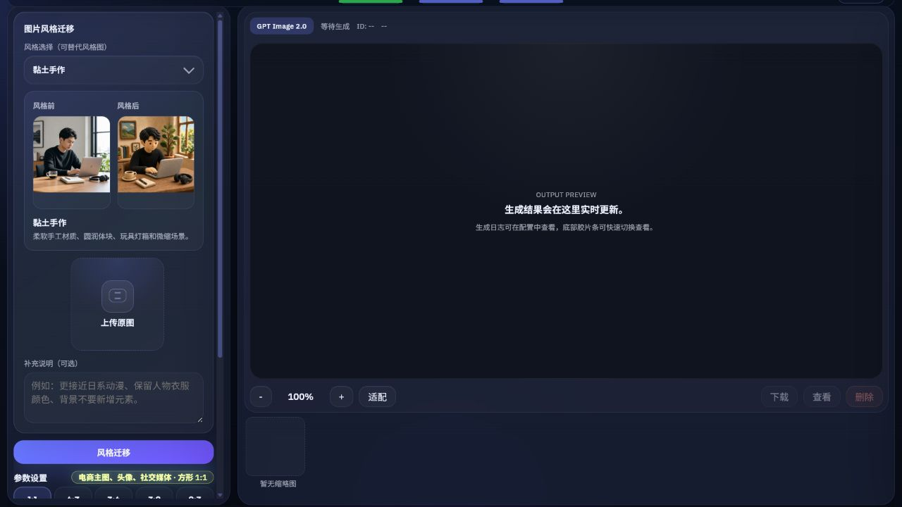
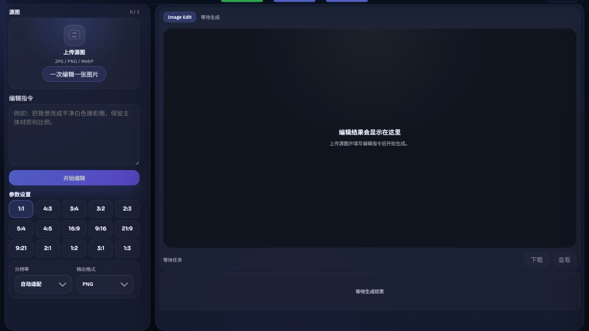
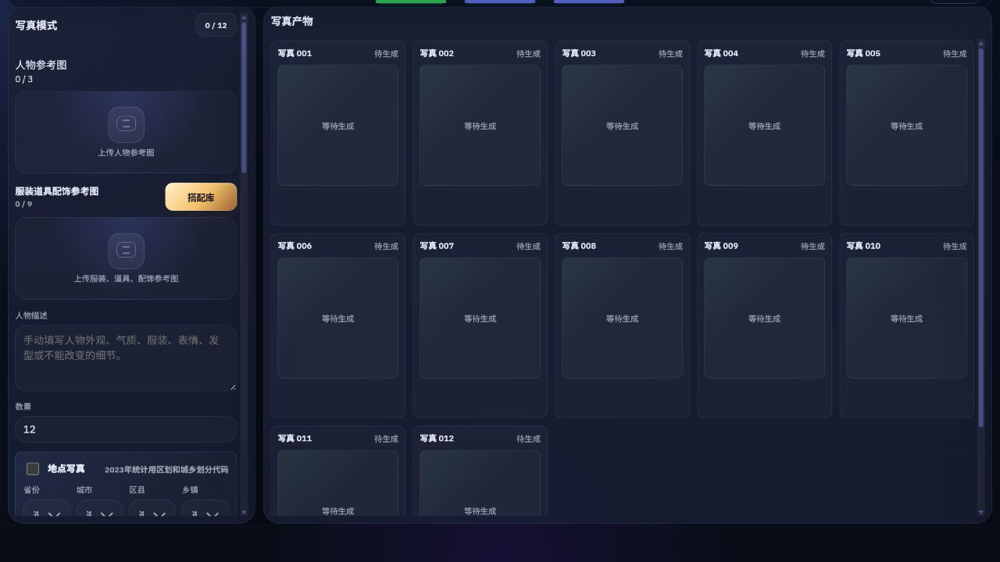
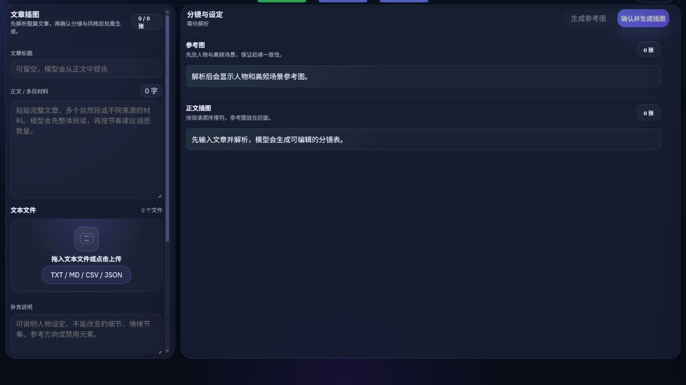
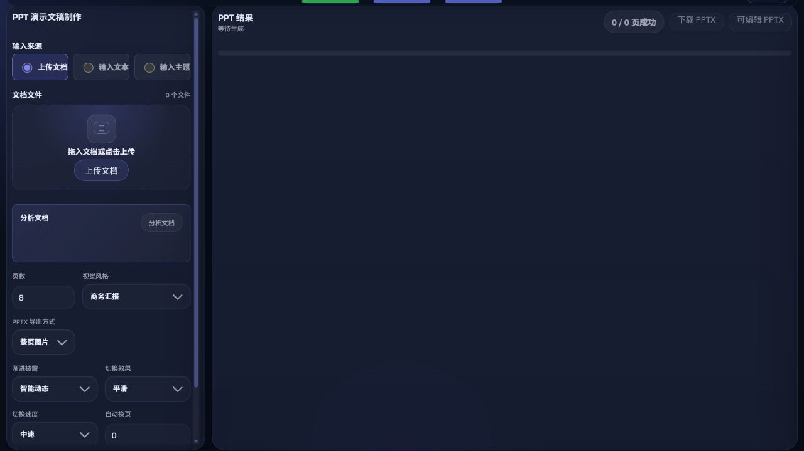
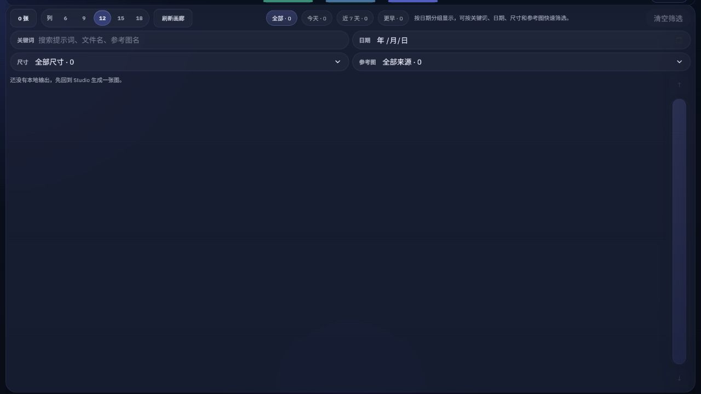

# GPT-Image2-Studio

[](https://github.com/aEboli/GPT-Image2-Studio/releases/latest) [](https://github.com/aEboli/GPT-Image2-Studio/actions/workflows/ci.yml) [](https://github.com/aEboli/GPT-Image2-Studio/releases/latest)

**An AI image and visual production workbench that runs on your computer.**

Create and edit images, plan ecommerce sets, draft multilingual listings, and turn articles or documents into illustrations and slides. Keep references, generation queues, retries, and saved assets together in a browser or a dedicated Windows app.

**English** · [简体中文](./README.zh-CN.md)

[Download](https://github.com/aEboli/GPT-Image2-Studio/releases/latest) · [Quick start](#quick-start) · [Server setup](#linux-server) · [API setup](#api-setup) · [Workflows](#workflows) · [Documentation](#documentation)

Current version: `v0.2.158`



## What's new in v0.2.158

- Plan each marketing set independently with one of 64 visual agents across eight creative directions; optionally guide a batch with a shared design direction.
- Detect repeated product actions across a set, improve functional and commercial CG prompts, and restore image-specific references for template plans.
- Review the references used by each image, identify saved sets by output language, and choose 6–20 images for new sets; reference reconstruction also supports zero generated images.
- Follow the expanded Linux deployment guide for installation, SSH access, systemd, HTTPS proxying, and updates.

See the [release notes](./docs/releases/v0.2.158.md) for upgrade details and verification. Each independently planned set uses a separate text-model request; saved plans keep their original prompts.

## Quick start

### Windows

Choose a package from [the latest release](https://github.com/aEboli/GPT-Image2-Studio/releases/latest):

- **[Desktop installer](https://github.com/aEboli/GPT-Image2-Studio/releases/latest/download/GPT-Image2-Studio-Desktop-Setup-v0.2.158-x64.exe)** — install the app and launch it from the desktop or Start menu.
- **[Portable ZIP](https://github.com/aEboli/GPT-Image2-Studio/releases/latest/download/GPT-Image2-Studio-Portable-v0.2.158-x64.zip)** — extract the entire archive, then run `GPT-Image2-Studio.exe`.

Both packages include the runtime; no separate Node.js installation is needed. Keep all portable files together. Installation, data paths, and build instructions are in the [Windows desktop guide](./docs/windows-desktop.md).

### Linux server

Run the browser workbench without a desktop environment. With **Git and Node.js 22.12+** installed, run this one line from the directory where you want the checkout to download the project, install all runtime dependencies, and start it:

```bash
git clone https://github.com/aEboli/GPT-Image2-Studio.git && cd GPT-Image2-Studio && npm ci --omit=dev && HOST=127.0.0.1 PORT=3600 NODE_ENV=production npm start
```

`--omit=dev` skips Electron and development tools. These installation commands are for a new deployment; the destination directory must not already exist. See the end of this section for updates.

<details>
<summary>New server: install Node.js, Git, and the project together (Ubuntu / Debian)</summary>

The following example targets Ubuntu 22.04 / 24.04 and Debian 12. Paste the entire block as a regular user with `sudo` access. It installs Node.js 22 through the NodeSource repository and puts the project in `~/apps/GPT-Image2-Studio`:

```bash
bash <<'BASH'
set -euo pipefail
sudo apt-get update
sudo apt-get install -y ca-certificates curl git
curl -fsSL https://deb.nodesource.com/setup_22.x | sudo -E bash -
sudo apt-get install -y nodejs
mkdir -p "$HOME/apps"
cd "$HOME/apps"
git clone https://github.com/aEboli/GPT-Image2-Studio.git
cd GPT-Image2-Studio
npm ci --omit=dev
HOST=127.0.0.1 PORT=3600 NODE_ENV=production npm start
BASH
```

</details>

The service listens at `http://127.0.0.1:3600` **on the server**. For personal remote access, run an SSH tunnel **on your own computer**, replacing `your-user@server-ip` with your server login:

```bash
ssh -N -L 127.0.0.1:13600:127.0.0.1:3600 your-user@server-ip
```

Keep the tunnel terminal open, visit **http://127.0.0.1:13600** in your local browser, and configure your API below. You do not need to open server port `3600`.

<details>
<summary>Run in the background and start on boot (systemd)</summary>

Press `Ctrl+C` to stop the foreground trial run, enter the project directory on the server (`cd ~/apps/GPT-Image2-Studio` for the full installation example), and run this as the same regular user:

```bash
bash <<'BASH'
set -euo pipefail
test -f server.mjs
studio_dir="$(pwd -P)"
studio_node="$(command -v node)"
sudo tee /etc/systemd/system/gpt-image2-studio.service >/dev/null <<EOF
[Unit]
Description=GPT-Image2-Studio
After=network-online.target
Wants=network-online.target

[Service]
Type=simple
User=$(id -un)
WorkingDirectory=$studio_dir
ExecStart="$studio_node" "$studio_dir/server.mjs"
Environment=NODE_ENV=production
Environment=HOST=127.0.0.1
Environment=PORT=3600
EnvironmentFile=-$studio_dir/.env
Restart=on-failure
RestartSec=5

[Install]
WantedBy=multi-user.target
EOF
sudo systemctl daemon-reload
sudo systemctl enable --now gpt-image2-studio
sudo systemctl status gpt-image2-studio --no-pager
BASH
```

Logs: `sudo journalctl -u gpt-image2-studio -f`. Restart: `sudo systemctl restart gpt-image2-studio`. Stop and disable startup: `sudo systemctl disable --now gpt-image2-studio`.

This systemd configuration reads `.env` from the project root; `npm start` by itself does not. Restart after changing environment settings. If the Node.js or project path changes, update the unit file and run `sudo systemctl daemon-reload`.

</details>

<details>
<summary>Access through a domain (Nginx HTTPS reverse proxy)</summary>

Prerequisites: a domain and HTTPS certificate are configured, Nginx runs on the same server as Studio, and you have created `/etc/nginx/studio.htpasswd` with `htpasswd` for browser login. The proxy authenticates users; a separate fixed token authenticates backend requests.

Generate a token with this command, put its value in `IMAGE_STUDIO_REQUEST_TOKEN` in the project's `.env`, run `chmod 600 .env`, and restart the systemd service above:

```bash
node -p "require('node:crypto').randomBytes(32).toString('hex')"
```

```dotenv
IMAGE_STUDIO_REQUEST_TOKEN=replace-with-generated-token
```

Add this `location` to the HTTPS `server` block that already has your certificate configured, replacing `replace-with-generated-token` with the same token:

```nginx
location / {
    auth_basic "GPT-Image2-Studio";
    auth_basic_user_file /etc/nginx/studio.htpasswd;
    client_max_body_size 128m;
    proxy_pass http://127.0.0.1:3600;
    proxy_http_version 1.1;
    proxy_set_header Host $host;
    proxy_set_header Connection "";
    proxy_set_header Authorization "";
    proxy_set_header X-Image-Studio-Token "replace-with-generated-token";
    proxy_buffering off;
    proxy_cache off;
    proxy_read_timeout 3600s;
    proxy_send_timeout 3600s;
}
```

Run `sudo nginx -t && sudo systemctl reload nginx`, then visit the HTTPS domain. Streaming progress requires proxy buffering to be disabled; adjust the upload limit for your assets. Keep the loopback listener and do not expose port `3600` directly to the internet. Read the [security guide](./SECURITY.md) for authentication and token rules.

</details>

On Linux, generated files default to the service user's `~/Pictures/`, and private configuration lives in the project's `.local/`; back up both. Set `IMAGE_STUDIO_OUTPUT_DIR` and `IMAGE_STUDIO_LOCAL_DATA_DIR` to customize these locations, using absolute paths in `.env`.

To update an existing deployment, back up configuration and generated files, wait for generation jobs to finish, and stop the service before running `git pull --ff-only && npm ci --omit=dev` in the project directory. With the systemd setup above, stop it with `sudo systemctl stop gpt-image2-studio`, then run `sudo systemctl start gpt-image2-studio` after the update succeeds.

### Source development (Windows)

Use **Node.js 22.12+** for the full development checkout, including Electron. The standalone Node.js service supports Node.js 20+.

```powershell
git clone https://github.com/aEboli/GPT-Image2-Studio.git
cd GPT-Image2-Studio
cmd /c npm ci
cmd /c npm start
```

Open **http://127.0.0.1:3600**. To use a different port, set `PORT` before starting:

```powershell
$env:PORT="3601"
cmd /c npm start
```

On Windows, `launch-studio.cmd` provides a browser launcher and accepts `-Port 3601`. It requires PowerShell 7.4+ (`pwsh.exe`). The `npm start` and desktop app paths do not require PowerShell 7.

## API setup

Studio requires **your own API credentials and model access**. Model usage is billed by the provider you configure.

1. Open **Configuration / 配置**. Use **CN / EN** to switch the interface language.
2. Select a channel and enter its base URL, API key, and model name.
3. Test the connection, fetch the available models if supported, and **save**.
4. Open **Prompt-to-image**, enter a short prompt, and try one image at the default size.

| Channel | Configuration |
| --- | --- |
| GPT · Route | A Responses connection with an image-generation tool. |
| GPT · Direct | Separate image and text/vision connections; they can use different providers. |
| Gemini | An image connection compatible with the selected Gemini route. |
| Grok | A Grok image-generation/editing connection. |

Text planning, analysis, and Listing drafts use the configured text/vision connection. A successful connection test verifies the model-list endpoint; check actual generation with the model and format you intend to use.

See [API configuration](./docs/configuration.md) for channel fields, model mappings, environment variables, and troubleshooting. Available models and accepted formats depend on your provider and account.

## Workflows

| Workspace | What you can do |
| --- | --- |
| **Image creation** | Generate from prompts and references, enhance prompts, and manage queued tasks. |
| **Image editing** | Edit a whole image or selected regions; transfer styles, blend references, and decompose product images. |
| **Image-to-prompt** | Extract reusable subject, composition, and visual-style instructions from a reference. |
| **Ecommerce sets** | Plan product and SKU images, create a coordinated set, and repair individual results. |
| **Listing drafts** | Generate or regenerate selected records; review and copy multilingual titles and product copy. |
| **Portraits** | Plan and generate a series from person, clothing, pose, and scene references. |
| **Article illustrations** | Build a storyboard and coordinated illustrations from article content. |
| **PPT** | Turn documents or a topic into slide images and export PPTX. |
| **Asset library** | Browse, filter, inspect, download, and revisit saved results and generation records. |

GPT prompt workflows offer PNG, JPG, WebP, GIF, and SVG controls where the configured model supports them. GIF/SVG requests have additional restrictions; ecommerce, portrait, article, and PPT image slots remain static workflows. See the [format and parameter reference](./docs/reference.md).

### Ecommerce tools

- **Temu workbook:** open the built-in editing workbench, maintain product and SKU fields, import Studio records explicitly, and export the template workbook. Batch quick export is available in the same panel.
- **Product image collector:** optionally collect and review images from supported product pages in Chrome or Edge. Follow the [extension guide](./extensions/product-image-collector/README.md) to install it.
- **Multilingual titles:** review English, German, Spanish, French, Italian, Polish, and Chinese titles when those translations are present. Non-title fields retain their existing language rules.

Listing drafts and exported workbooks require review. Studio does not log in to a marketplace or publish products automatically.

## Interface previews

These are interface examples; sample content is not a guarantee of model output. Open a section to view its screenshot at full width.

<details>
<summary>Ecommerce set planning</summary>



</details>

<details>
<summary>Style transfer and image editing</summary>

### Style transfer



### Image editing



</details>

<details>
<summary>Portraits, article illustrations, and PPT</summary>

### Portraits



### Article illustrations



### PPT



</details>

<details>
<summary>Asset gallery</summary>



</details>

## Data and deployment

Local outputs default to `%USERPROFILE%\Pictures\YYYY-MM\MM-DD\`; record indexes normally live under `%USERPROFILE%\Pictures\json\`. Use `IMAGE_STUDIO_OUTPUT_DIR` to choose an output location. Desktop configuration lives under `%APPDATA%\GPT-Image2-Studio`; source-mode private service configuration lives in `.local/`.

Credentials and saved assets stay in the selected runtime's storage. Prompts, reference images, and requests are sent to the API provider you configure. Keep `.env`, `.local/`, generated assets, and real request logs out of commits.

The repository includes `vercel.json` for cloud deployment. Vercel runtime files use temporary storage: validate SSE, job duration, and persistence needs before relying on a hosted deployment. Local or desktop use is the default for persistent creative work.

For remote access, put the loopback service behind an authenticated TLS **reverse proxy** and configure an explicit **fixed token** with `IMAGE_STUDIO_REQUEST_TOKEN`. The proxy must send that token on backend requests. Read the [security guide](./SECURITY.md) for Basic, Bearer, and `X-Image-Studio-Token` behavior.

<details>
<summary>DNS troubleshooting</summary>

The Node service tries system `dns.lookup` first. On lookup failure, fallback candidates include `223.5.5.5`, `1.1.1.1`, and the system DNS servers. Set `IMAGE_STUDIO_DISABLE_DNS_FALLBACK=1` to disable fallback, or set `IMAGE_STUDIO_DNS_FALLBACK_SERVERS` to a comma-, semicolon-, or whitespace-separated list.

</details>

## Development

```powershell
cmd /c npm test
cmd /c npm run sync:public-lib -- --check
cmd /c npm run check:release
cmd /c npx --no-install openspec validate --all --strict
git diff --check
```

Use `npm run desktop` for Electron development and `npm run help` for the image-generation CLI. Desktop releases also require `npm run test:desktop-smoke` and `npm run build:desktop`.

Changes to application behavior follow the [OpenSpec and contribution workflow](./CONTRIBUTING.md). Shared browser modules are maintained in `lib/` and synchronized into `public/lib/` with `npm run sync:public-lib`.

## Documentation

| Guide | Contents |
| --- | --- |
| [API configuration](./docs/configuration.md) | Connection setup, saved providers, environment variables, and troubleshooting. |
| [Workflow and parameter reference](./docs/reference.md) | Formats, resolutions, workflow limits, and Temu export. |
| [Windows desktop](./docs/windows-desktop.md) | Installation, portable use, data storage, and packaging. |
| [Product image collector](./extensions/product-image-collector/README.md) | Browser extension setup and supported page collection. |
| [Security](./SECURITY.md) · [Contributing](./CONTRIBUTING.md) | Trust boundaries, verification, and release maintenance. |
| [Legacy browser installer](./docs/windows-installer.md) | Building the compatibility installer locally. |

## Releases

Current release notes: [v0.2.158](./docs/releases/v0.2.158.md). Download packages and check their SHA-256 values in [GitHub Releases](https://github.com/aEboli/GPT-Image2-Studio/releases/latest). Older notes remain in the [release archive](./docs/releases/) and [version history](./docs/history.md).

Versions use `major.minor.patch` with a three-digit patch segment. Feature releases add `0.010`; ordinary updates add `0.001`. Use the maintained `release:major`, `release:minor`, `release:feature`, or `release:patch` command with `--summary`. A tagged release must pass `npm run check:release:strict` from a clean worktree.
