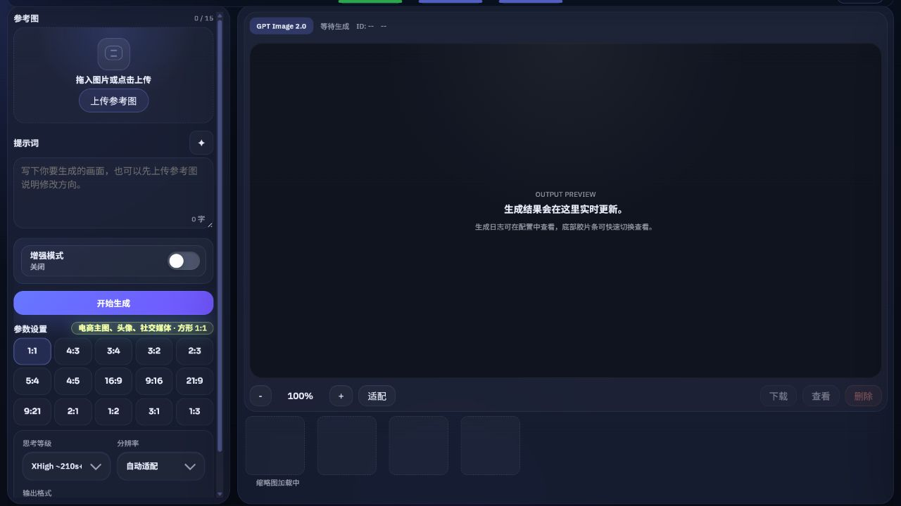
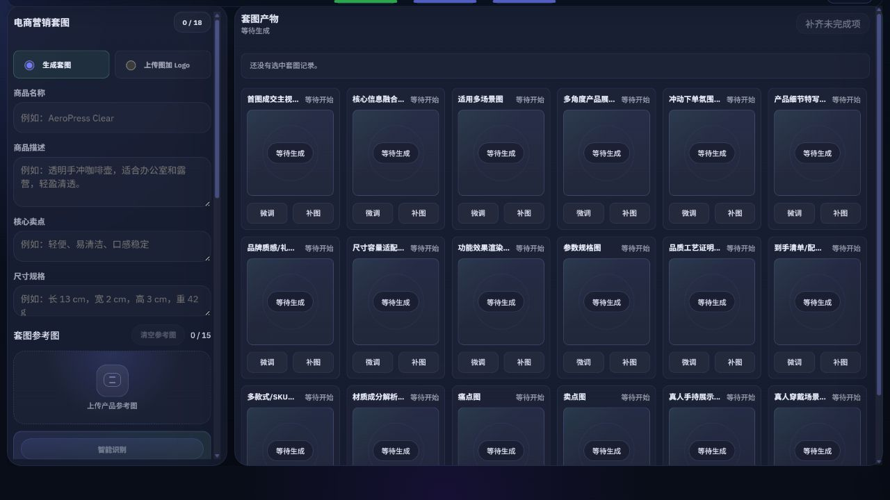
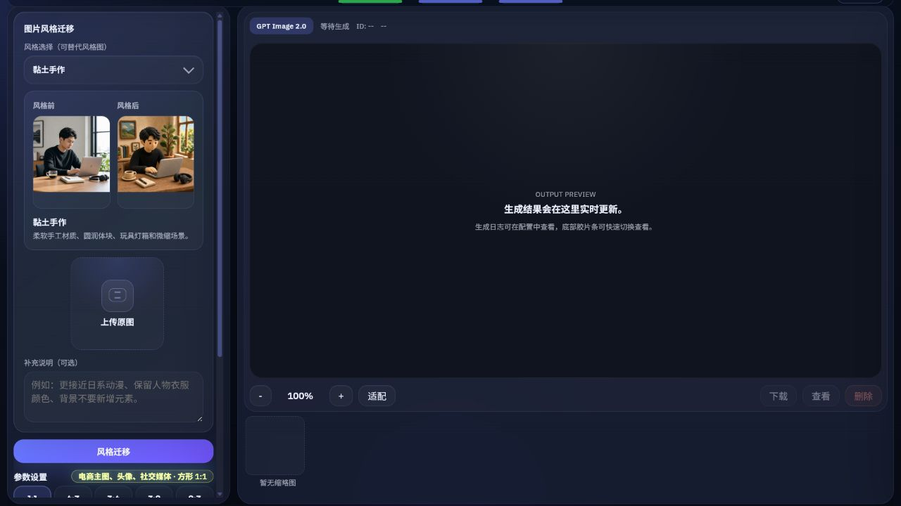
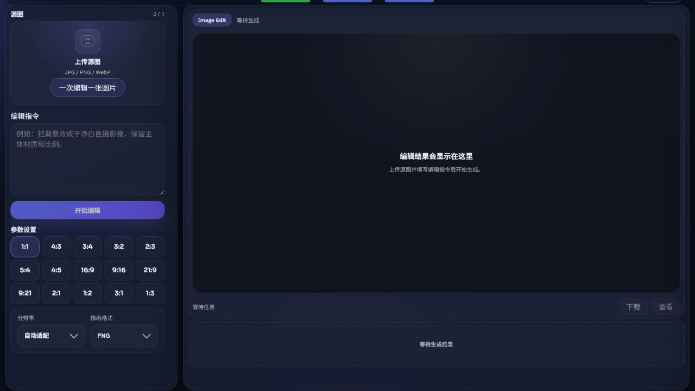
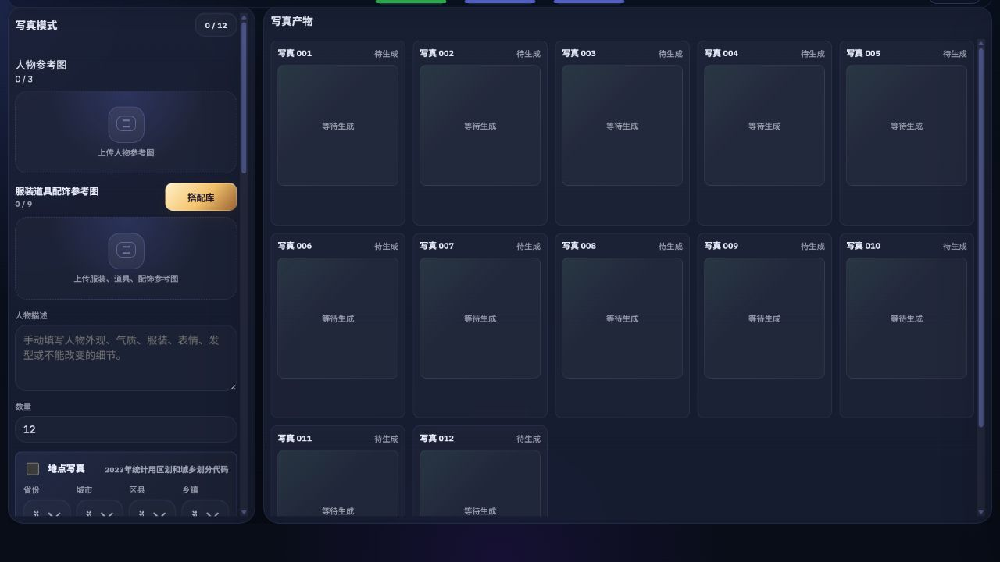
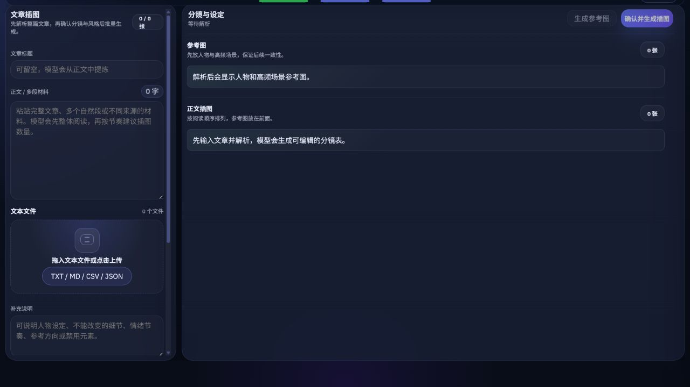
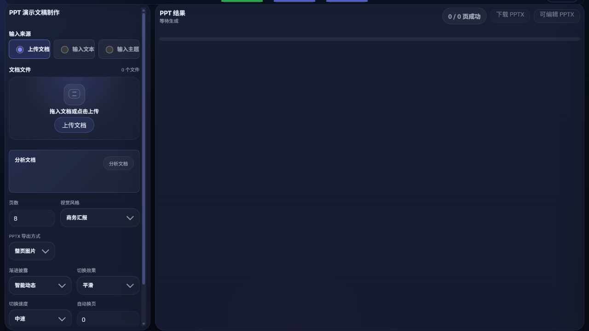
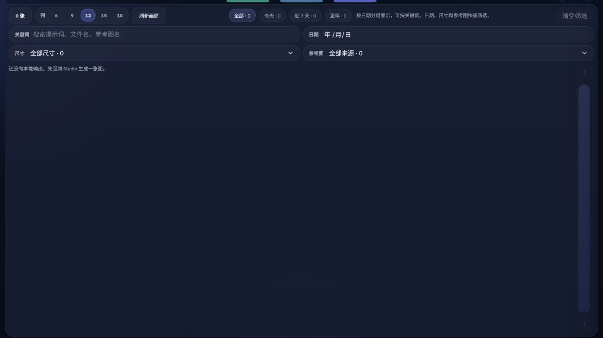

# GPT-Image2-Studio

[](https://github.com/aEboli/GPT-Image2-Studio/releases/latest) [](https://github.com/aEboli/GPT-Image2-Studio/actions/workflows/ci.yml) [](https://github.com/aEboli/GPT-Image2-Studio/releases/latest)

**An AI image and visual production workbench that runs on your computer.**

Create and edit images, plan ecommerce sets, draft multilingual listings, and turn articles or documents into illustrations and slides. Keep references, generation queues, retries, and saved assets together in a browser or a dedicated Windows app.

**English** · [简体中文](./README.zh-CN.md)

[Download](https://github.com/aEboli/GPT-Image2-Studio/releases/latest) · [Quick start](#quick-start) · [API setup](#api-setup) · [Workflows](#workflows) · [Documentation](#documentation)

Current version: `v0.2.148`



## Quick start

### Windows

Choose a package from [the latest release](https://github.com/aEboli/GPT-Image2-Studio/releases/latest):

- **[Desktop installer](https://github.com/aEboli/GPT-Image2-Studio/releases/latest/download/GPT-Image2-Studio-Desktop-Setup-v0.2.148-x64.exe)** — install the app and launch it from the desktop or Start menu.
- **[Portable ZIP](https://github.com/aEboli/GPT-Image2-Studio/releases/latest/download/GPT-Image2-Studio-Portable-v0.2.148-x64.zip)** — extract the entire archive, then run `GPT-Image2-Studio.exe`.

Both packages include the runtime; no separate Node.js installation is needed. Keep all portable files together. Installation, data paths, and build instructions are in the [Windows desktop guide](./docs/windows-desktop.md).

### From source

Use **Node.js 22.12+** for the full development checkout, including Electron. The standalone Node.js service supports Node.js 20+.

```powershell
git clone https://github.com/aEboli/GPT-Image2-Studio.git
cd GPT-Image2-Studio
cmd /c npm ci
cmd /c npm start
```

Open **http://127.0.0.1:3600**. To use a different port, set `PORT` before starting:

```powershell
$env:PORT="3601"
cmd /c npm start
```

On Windows, `launch-studio.cmd` provides a browser launcher and accepts `-Port 3601`. It requires PowerShell 7.4+ (`pwsh.exe`). The `npm start` and desktop app paths do not require PowerShell 7.

## API setup

Studio requires **your own API credentials and model access**. Model usage is billed by the provider you configure.

1. Open **Configuration / 配置**. Use **CN / EN** to switch the interface language.
2. Select a channel and enter its base URL, API key, and model name.
3. Test the connection, fetch the available models if supported, and **save**.
4. Open **Prompt-to-image**, enter a short prompt, and try one image at the default size.

| Channel | Configuration |
| --- | --- |
| GPT · Route | A Responses connection with an image-generation tool. |
| GPT · Direct | Separate image and text/vision connections; they can use different providers. |
| Gemini | An image connection compatible with the selected Gemini route. |
| Grok | A Grok image-generation/editing connection. |

Text planning, analysis, and Listing drafts use the configured text/vision connection. A successful connection test verifies the model-list endpoint; check actual generation with the model and format you intend to use.

See [API configuration](./docs/configuration.md) for channel fields, model mappings, environment variables, and troubleshooting. Available models and accepted formats depend on your provider and account.

## Workflows

| Workspace | What you can do |
| --- | --- |
| **Image creation** | Generate from prompts and references, enhance prompts, and manage queued tasks. |
| **Image editing** | Edit a whole image or selected regions; transfer styles, blend references, and decompose product images. |
| **Image-to-prompt** | Extract reusable subject, composition, and visual-style instructions from a reference. |
| **Ecommerce sets** | Plan product and SKU images, create a coordinated set, and repair individual results. |
| **Listing drafts** | Generate or regenerate selected records; review and copy multilingual titles and product copy. |
| **Portraits** | Plan and generate a series from person, clothing, pose, and scene references. |
| **Article illustrations** | Build a storyboard and coordinated illustrations from article content. |
| **PPT** | Turn documents or a topic into slide images and export PPTX. |
| **Asset library** | Browse, filter, inspect, download, and revisit saved results and generation records. |

GPT prompt workflows offer PNG, JPG, WebP, GIF, and SVG controls where the configured model supports them. GIF/SVG requests have additional restrictions; ecommerce, portrait, article, and PPT image slots remain static workflows. See the [format and parameter reference](./docs/reference.md).

### Ecommerce tools

- **Temu workbook:** open the built-in editing workbench, maintain product and SKU fields, import Studio records explicitly, and export the template workbook. Batch quick export is available in the same panel.
- **Product image collector:** optionally collect and review images from supported product pages in Chrome or Edge. Follow the [extension guide](./extensions/product-image-collector/README.md) to install it.
- **Multilingual titles:** review English, German, Spanish, French, Italian, Polish, and Chinese titles when those translations are present. Non-title fields retain their existing language rules.

Listing drafts and exported workbooks require review. Studio does not log in to a marketplace or publish products automatically.

## Interface previews

These are interface examples; sample content is not a guarantee of model output. Open a section to view its screenshot at full width.

<details>
<summary>Ecommerce set planning</summary>



</details>

<details>
<summary>Style transfer and image editing</summary>

### Style transfer



### Image editing



</details>

<details>
<summary>Portraits, article illustrations, and PPT</summary>

### Portraits



### Article illustrations



### PPT



</details>

<details>
<summary>Asset gallery</summary>



</details>

## Data and deployment

Local outputs default to `%USERPROFILE%\Pictures\YYYY-MM\MM-DD\`; record indexes normally live under `%USERPROFILE%\Pictures\json\`. Use `IMAGE_STUDIO_OUTPUT_DIR` to choose an output location. Desktop configuration lives under `%APPDATA%\GPT-Image2-Studio`; source-mode private service configuration lives in `.local/`.

Credentials and saved assets stay in the selected runtime's storage. Prompts, reference images, and requests are sent to the API provider you configure. Keep `.env`, `.local/`, generated assets, and real request logs out of commits.

The repository includes `vercel.json` for cloud deployment. Vercel runtime files use temporary storage: validate SSE, job duration, and persistence needs before relying on a hosted deployment. Local or desktop use is the default for persistent creative work.

For remote access, put the loopback service behind an authenticated TLS **reverse proxy** and configure an explicit **fixed token** with `IMAGE_STUDIO_REQUEST_TOKEN`. The proxy must send that token on backend requests. Read the [security guide](./SECURITY.md) for Basic, Bearer, and `X-Image-Studio-Token` behavior.

<details>
<summary>DNS troubleshooting</summary>

The Node service tries system `dns.lookup` first. On lookup failure, fallback candidates include `223.5.5.5`, `1.1.1.1`, and the system DNS servers. Set `IMAGE_STUDIO_DISABLE_DNS_FALLBACK=1` to disable fallback, or set `IMAGE_STUDIO_DNS_FALLBACK_SERVERS` to a comma-, semicolon-, or whitespace-separated list.

</details>

## Development

```powershell
cmd /c npm test
cmd /c npm run sync:public-lib -- --check
cmd /c npm run check:release
cmd /c npx --no-install openspec validate --all --strict
git diff --check
```

Use `npm run desktop` for Electron development and `npm run help` for the image-generation CLI. Desktop releases also require `npm run test:desktop-smoke` and `npm run build:desktop`.

Changes to application behavior follow the [OpenSpec and contribution workflow](./CONTRIBUTING.md). Shared browser modules are maintained in `lib/` and synchronized into `public/lib/` with `npm run sync:public-lib`.

## Documentation

| Guide | Contents |
| --- | --- |
| [API configuration](./docs/configuration.md) | Connection setup, saved providers, environment variables, and troubleshooting. |
| [Workflow and parameter reference](./docs/reference.md) | Formats, resolutions, workflow limits, and Temu export. |
| [Windows desktop](./docs/windows-desktop.md) | Installation, portable use, data storage, and packaging. |
| [Product image collector](./extensions/product-image-collector/README.md) | Browser extension setup and supported page collection. |
| [Security](./SECURITY.md) · [Contributing](./CONTRIBUTING.md) | Trust boundaries, verification, and release maintenance. |
| [Legacy browser installer](./docs/windows-installer.md) | Building the compatibility installer locally. |

## Releases

Current release notes: [v0.2.148](./docs/releases/v0.2.148.md). Download packages and check their SHA-256 values in [GitHub Releases](https://github.com/aEboli/GPT-Image2-Studio/releases/latest). Older notes remain in the [release archive](./docs/releases/) and [version history](./docs/history.md).

Versions use `major.minor.patch` with a three-digit patch segment. Feature releases add `0.010`; ordinary updates add `0.001`. Use the maintained `release:major`, `release:minor`, `release:feature`, or `release:patch` command with `--summary`. A tagged release must pass `npm run check:release:strict` from a clean worktree.
