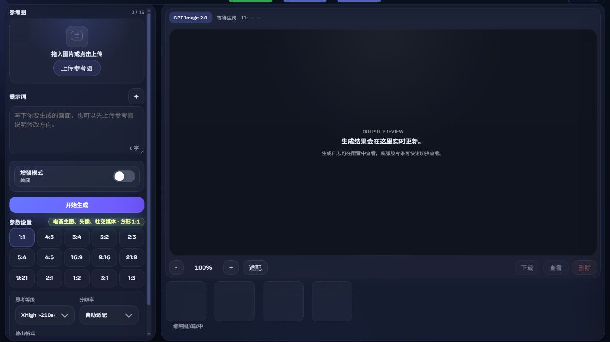
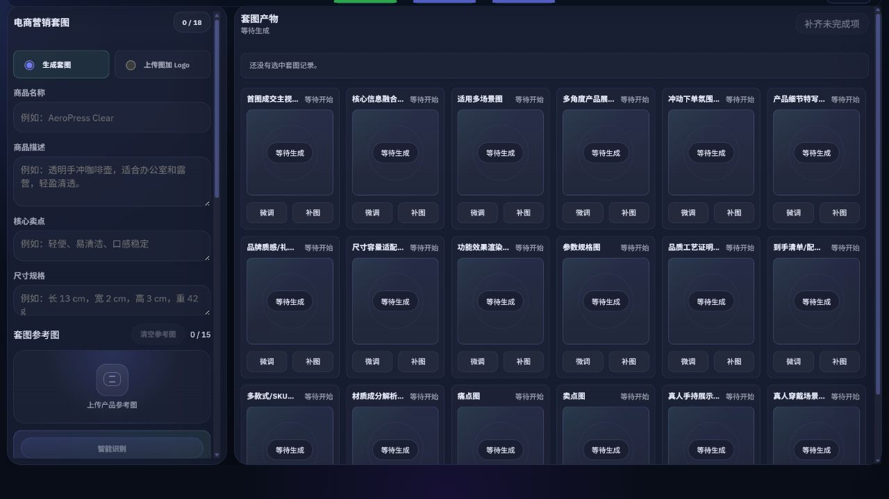
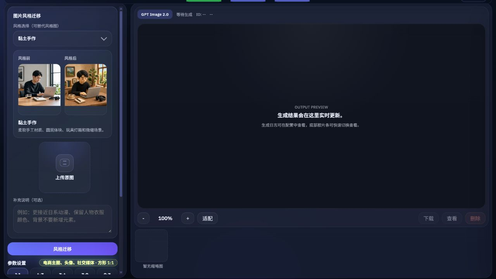
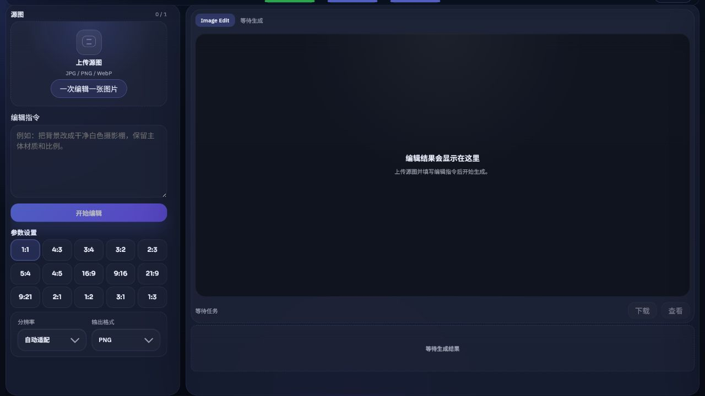
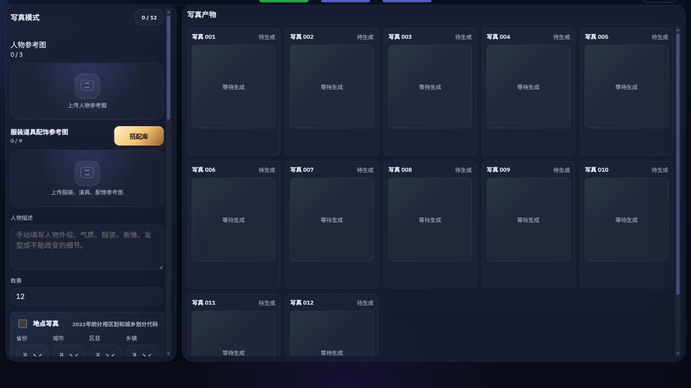
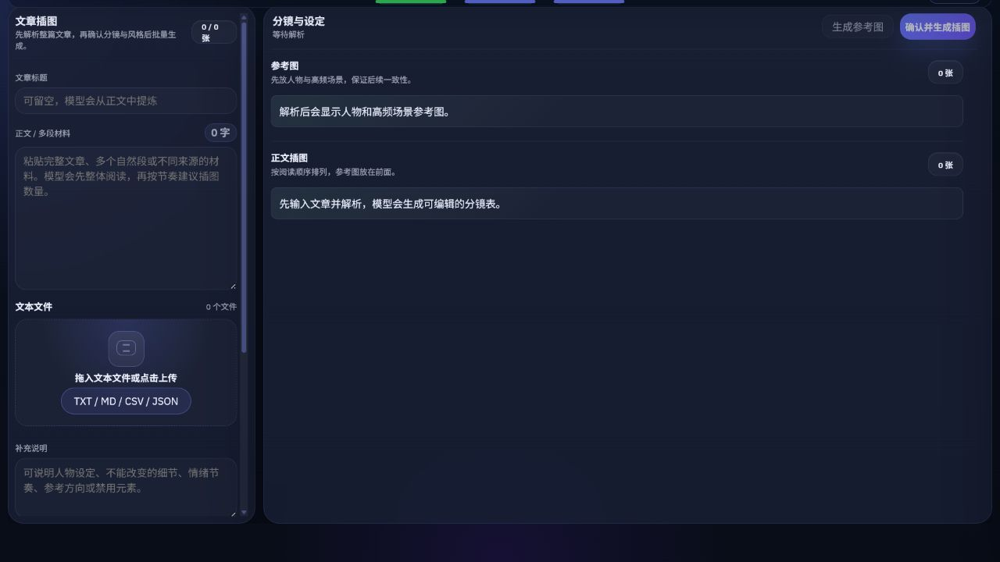
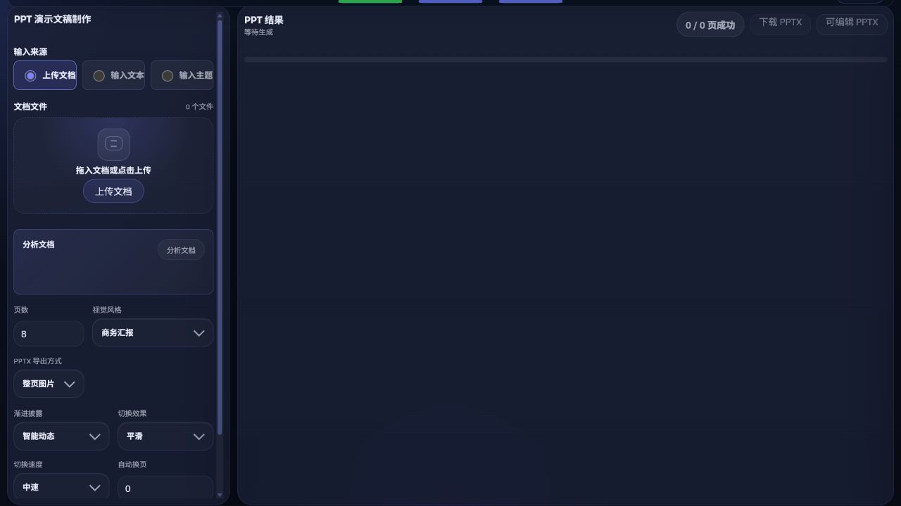
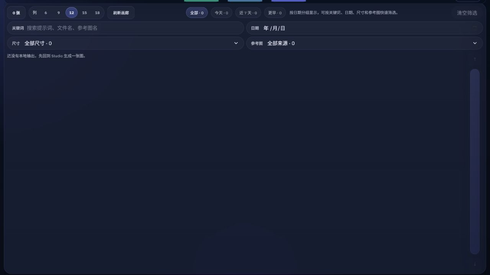

# GPT-Image2-Studio

[](https://github.com/aEboli/GPT-Image2-Studio/releases/latest) [](https://github.com/aEboli/GPT-Image2-Studio/actions/workflows/ci.yml) [](https://github.com/aEboli/GPT-Image2-Studio/releases/latest)

**在自己电脑上运行的 AI 图像与视觉创作工作台。**

从图片生成与编辑，到电商套图、多语言 Listing、文章插图和 PPT，把参考素材、生成队列、失败重试与历史资产放在同一套工作流中。可以通过浏览器使用，也可以安装独立 Windows 桌面程序。

[English](./README.md) · **简体中文**

[下载](https://github.com/aEboli/GPT-Image2-Studio/releases/latest) · [快速开始](#快速开始) · [配置 API](#配置-api) · [功能](#功能) · [文档](#文档)

当前版本：`v0.2.148`



## 快速开始

### Windows

从[最新发行版](https://github.com/aEboli/GPT-Image2-Studio/releases/latest)选择一种方式：

- **[桌面安装包](https://github.com/aEboli/GPT-Image2-Studio/releases/latest/download/GPT-Image2-Studio-Desktop-Setup-v0.2.148-x64.exe)**：安装后，从桌面或开始菜单启动。
- **[便携 ZIP](https://github.com/aEboli/GPT-Image2-Studio/releases/latest/download/GPT-Image2-Studio-Portable-v0.2.148-x64.zip)**：完整解压后，运行 `GPT-Image2-Studio.exe`。

两种方式均自带运行时，无需另装 Node.js。便携版的解压文件需要放在一起。安装、数据位置与构建说明见 [Windows 桌面文档](./docs/windows-desktop.md)。

### 源码运行

完整开发环境使用 **Node.js 22.12+**，包含 Electron 依赖；独立 Node.js 服务支持 Node.js 20+。

```powershell
git clone https://github.com/aEboli/GPT-Image2-Studio.git
cd GPT-Image2-Studio
cmd /c npm ci
cmd /c npm start
```

打开 **http://127.0.0.1:3600**。需要其他端口时，先设置 `PORT`：

```powershell
$env:PORT="3601"
cmd /c npm start
```

Windows 也可使用 `launch-studio.cmd` 启动浏览器工作台，支持 `-Port 3601`。该启动器要求 PowerShell 7.4+（`pwsh.exe`）；`npm start` 与桌面程序不要求 PowerShell 7。

## 配置 API

Studio 需要**自行提供 API 密钥和模型权限**，模型调用费用由所选服务商收取。

1. 打开右上角**配置**，通过 **CN / EN** 切换界面语言。
2. 选择通道，填写接口地址、API Key 和模型名称。
3. 测试连接；服务商支持时获取模型列表，然后**保存**。
4. 回到**提示词生图**，输入简短提示词，先用默认尺寸生成一张图。

| 通道 | 配置方式 |
| --- | --- |
| GPT · 路由模式 | 配置支持图像生成工具的 Responses 接口。 |
| GPT · 直连模式 | 分别配置生图与文字／视觉接口，可使用不同服务商。 |
| Gemini | 配置与所选 Gemini 路线兼容的生图接口。 |
| Grok | 配置 Grok 生图／编辑接口。 |

规划、分析和 Listing 使用已配置的文字／视觉接口。连接测试成功只表示模型列表接口可访问；实际生图还需验证选用的模型与格式。

各通道字段、模型映射、环境变量和常见错误见 [API 配置教程](./docs/configuration.zh-CN.md)。可用模型和支持的格式以服务商及账户权限为准。

## 功能

| 工作区 | 主要用途 |
| --- | --- |
| **图片创作** | 提示词与参考图生图、提示词增强、生成队列。 |
| **图片编辑** | 整图与局部编辑、风格迁移、参考图混合、产品结构分解。 |
| **图片转提示词** | 提取主体、构图和视觉风格，形成可复用的提示词。 |
| **电商套图** | 规划商品及 SKU 图片，生成整套素材，单独补图与修复。 |
| **Listing 草稿** | 为勾选记录生成或重新生成，审阅与复制多语言标题和商品文案。 |
| **写真** | 根据人物、服装、姿态和场景参考生成系列图片。 |
| **文章插图** | 根据文章内容规划分镜，生成风格一致的插图。 |
| **PPT** | 根据文档或主题生成幻灯片图片并导出 PPTX。 |
| **资产库** | 浏览、筛选、预览、下载，并回看生成记录。 |

GPT 提示词生图提供 PNG、JPG、WebP、GIF 和 SVG 控件，实际支持取决于所选模型。GIF／SVG 有额外限制；套图、写真、文章和 PPT 的图片槽位仍使用静态图像。详见[格式与参数参考](./docs/reference.zh-CN.md)。

### 电商工具

- **Temu 表格工作台**：维护商品和 SKU 字段，手动导入 Studio 记录，导出模板工作簿；同一面板也提供批量快捷导出。
- **商品图采集插件**：在 Chrome／Edge 中采集和审阅已支持商品页面的图片，安装方式见[插件说明](./extensions/product-image-collector/README.md)。
- **多语言标题**：存在对应译文时，展示英、德、西、法、意、波、中七语标题；其他字段沿用原有语言规则。

Listing 草稿和导出表格需要人工复核。Studio 不会自动登录店铺或发布商品。

## 界面预览

以下为界面示例，示例内容不代表模型的固定输出。展开后可查看完整宽度截图。

<details>
<summary>电商套图规划</summary>



</details>

<details>
<summary>风格迁移与图片编辑</summary>

### 风格迁移



### 图片编辑



</details>

<details>
<summary>写真、文章插图与 PPT</summary>

### 写真



### 文章插图



### PPT



</details>

<details>
<summary>资产画廊</summary>



</details>

## 数据与部署

本地输出默认位于 `%USERPROFILE%\Pictures\YYYY-MM\MM-DD\`，记录索引通常位于 `%USERPROFILE%\Pictures\json\`。可通过 `IMAGE_STUDIO_OUTPUT_DIR` 指定输出位置。桌面配置保存在 `%APPDATA%\GPT-Image2-Studio`，源码模式的服务端私有配置保存在 `.local/`。

密钥和已保存资产存放在所选运行环境中。提示词、参考图和请求会发送给你配置的 API 服务商。不要把 `.env`、`.local/`、生成资产或真实请求日志提交到仓库。

仓库提供 `vercel.json`。Vercel 运行时文件使用临时存储，需要先验证 SSE、任务时长和持久化需求；需要长期保留创作内容时，默认使用本地或桌面版本。

远程访问时，应通过完成身份认证的 TLS 反向代理连接回环服务，并显式设置 `IMAGE_STUDIO_REQUEST_TOKEN`。TLS 反向代理不能依赖后端弹出登录框；长期运行的反向代理应显式配置固定强令牌，并为后端请求携带该令牌。Basic、Bearer 和 `X-Image-Studio-Token` 的规则见[安全说明](./SECURITY.md)。

<details>
<summary>DNS 故障排查</summary>

Node 服务优先使用系统 `dns.lookup`。解析失败时，备用候选包括 `223.5.5.5`、`1.1.1.1` 和系统 DNS。设置 `IMAGE_STUDIO_DISABLE_DNS_FALLBACK=1` 可禁用；`IMAGE_STUDIO_DNS_FALLBACK_SERVERS` 支持用逗号、分号或空白分隔的自定义服务器列表。

</details>

## 开发

```powershell
cmd /c npm test
cmd /c npm run sync:public-lib -- --check
cmd /c npm run check:release
cmd /c npx --no-install openspec validate --all --strict
git diff --check
```

`npm run desktop` 用于 Electron 开发；`npm run help` 查看命令行生图参数。桌面发行还需执行 `npm run test:desktop-smoke` 和 `npm run build:desktop`。

应用行为变更遵循 [OpenSpec 与贡献流程](./CONTRIBUTING.md)。浏览器共享模块在 `lib/` 维护，通过 `npm run sync:public-lib` 同步到 `public/lib/`。

## 文档

| 文档 | 内容 |
| --- | --- |
| [API 配置](./docs/configuration.zh-CN.md) | 接口设置、服务商清单、环境变量和故障排查。 |
| [工作流与参数参考](./docs/reference.zh-CN.md) | 输出格式、分辨率、数量限制和 Temu 导出。 |
| [Windows 桌面程序](./docs/windows-desktop.md) | 安装、便携运行、数据位置和打包。 |
| [商品图采集插件](./extensions/product-image-collector/README.md) | 插件安装和支持的商品页面采集。 |
| [安全说明](./SECURITY.md) · [贡献指南](./CONTRIBUTING.md) | 信任边界、验证和发行维护。 |
| [旧版浏览器安装包](./docs/windows-installer.md) | 在本地构建兼容安装包。 |

## 发行版

当前版本说明：[v0.2.148](./docs/releases/v0.2.148.md)。下载与 SHA-256 校验值见 [GitHub Releases](https://github.com/aEboli/GPT-Image2-Studio/releases/latest)；较早记录保留在[发行说明目录](./docs/releases/)和[历史更新记录](./docs/history.zh-CN.md)。

版本格式为 `major.minor.patch`，更新位固定三位数字。小功能更新加 `0.010`，普通更新加 `0.001`；通过 `release:major`、`release:minor`、`release:feature` 或 `release:patch` 配合 `--summary` 维护。正式发布提交和标签需在干净工作树中通过 `npm run check:release:strict`。
